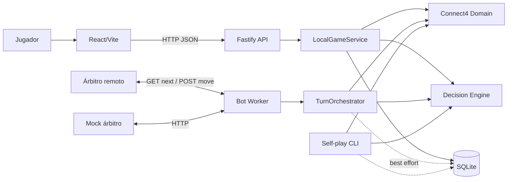

# PLAN_BACKEND.md — Arquitectura e implementación del backend Connect4 8×7

**Versión:** 2.1 · **Estado:** Contrato técnico propuesto para validación del equipo antes de implementar.  
**Responsables:** Salva (arquitectura/worker), Jorge (reglas y algoritmo), Juan (API/persistencia), Alex (QA y simulador).  
**Contrato externo:** Árbitro HTTP OpenAPI `1.0.1`, disponible en el repositorio como especificación de integración. El servidor remoto expone `GET /api/openapi.json`; ante diferencias de versión se adapta únicamente el cliente de infraestructura, preservando el dominio.

> **Secuencia de implementación:** aprobar los contratos de este plan y de `PLAN_FRONTEND.md`, versionarlos en el commit inicial y después comenzar a desarrollar. Registrar decisiones posteriores y cambios de alcance en `docs/TECNICO.md` y `docs/ADR.md`.

## 1. Objetivo, alcance y criterios técnicos de éxito

Desarrollar un único **motor Connect4 8×7** para: (a) un bot local autónomo que consulta al árbitro oficial con long polling y responde sin intervención humana; (b) un juego humano contra bot mediante la API propia; (c) simulación local, benchmarks y prácticas contra bots de la casa. El motor, las reglas y las estrategias son módulos puros, sin HTTP ni persistencia.

**Componentes de la primera versión:** reglas correctas (caída, legalidad, cuatro direcciones de victoria, empate); estrategia funcional y explicable; cliente HTTP del árbitro; worker continuo; API para frontend; mock del árbitro; pruebas automatizadas ejecutables por un único comando, con cobertura mínima del 70% en reglas y algoritmo y objetivo interno del 85%; documentación de operación y arquitectura. **Capacidades añadidas previstas:** historial persistente SQLite, entrenamiento local, estrategia básica de respaldo, benchmark, telemetría, extensiones opt-in de ponderación y asesoría LLM. No se considerará implementada una capacidad solo porque exista un switch.

**Prioridades:** P0 = worker confiable sin jugadas ilegales ni interrupciones y aplicación web funcional; P1 = optimizar estrategia y validación; P2 = mejoras experimentales con pruebas y límites. La sofisticación nunca bloquea P0.

**Medidas de aceptación:** 0 movimientos ilegales en las pruebas de simulación; finalización de partidas completas; modo offline/local independiente del árbitro; 0 tokens filtrados; worker estable durante su operación; decisiones dentro de presupuesto local y POST a tiempo en condiciones verificadas; suite completa en `npm test`; cobertura reportada; documentación de arquitectura y decisiones verificable mediante código y pruebas.

## 2. Reglas y fuentes de verdad

- Tablero: **7 filas × 8 columnas**, `board[row][column]`, `row=0` inferior. `0` vacío, `1` jugador inicial, `2` jugador siguiente.
- Columnas 0..7; las fichas caen a la fila desocupada más baja; ganar = cuatro fichas consecutivas verticales, horizontales o diagonales; empate = tablero lleno sin ganador.
- El árbitro es la **fuente oficial de verdad del torneo** y decide turnos, partidas, tiempo y ganador. En modo local, la API/SQLite son autoridad; React no lo es.
- El ejemplo ilustrativo de `Turn` de una versión de la especificación contiene discrepancias entre fichas, `moves`, `turn`, `you` y `last_move`; no representa un estado de juego válido. **No usarlo como fixture válido.** Crear fixtures coherentes a partir de jugadas simuladas y mantener un fixture inválido para probar detección de inconsistencias.
- Si datos oficiales discrepan: validar el tablero y la identidad `you`, recalcular legalidad local, comparar con `legal_moves`, registrar discrepancia; no asumir automáticamente que se puede continuar ni arriesgar una jugada ilegal. La política segura se define en el orquestador y se prueba; ante un conflicto de contrato, comparar con el OpenAPI vigente del servidor y conservar evidencia diagnóstica.

## 3. Decisiones arquitectónicas aprobables (ADR)

| ID | Decisión | Motivación / límite |
|---|---|---|
| ADR-01 | **JavaScript ESM**, Node.js 22 LTS o superior compatible; JSDoc; sin TypeScript | Respeta el stack del equipo y permite contratos explícitos sin conversión de lenguaje. |
| ADR-02 | **Monorepo npm workspaces** | Código organizado en un único repositorio, con módulos reutilizables y procesos ejecutables por separado. |
| ADR-03 | **Fastify** para API local | REST pequeño, validación JSON Schema, fácil de probar con `inject()`. |
| ADR-04 | **Vitest** + V8 coverage | Un comando `npm test` incluyendo pruebas y cobertura. |
| ADR-05 | **SQLite**, via `better-sqlite3` en Node local | Persistencia ACID simple para partidas humanas, movimientos, sesiones de prueba y diagnóstico; BD no es dependencia de un movimiento oficial. |
| ADR-06 | **Dominio / engine puros**, adaptadores externos | Misma lógica desde API, CLI, tests y worker; sin dependencia de Fastify, SQLite, React o árbitro. |
| ADR-07 | **Bot worker Node.js persistente** que ejecuta long polling HTTP | El árbitro recibe peticiones salientes y no invoca nuestra API. No requiere puertos abiertos ni Lambda. |
| ADR-08 | **Estrategia seleccionable**, por defecto Negamax con alpha-beta; básica como fallback | Mejor calidad sin comprometer legalidad/tiempo. |
| ADR-09 | **Una instancia del bot por token** | Evitar colisiones, turnos concurrentes y POST duplicados; bloqueo de instancia. |
| ADR-10 | **Eventos internos + SSE opt-in** para telemetría visual | No reemplaza HTTP obligatorio del árbitro. WebSockets solo si surge necesidad bidireccional real. |
| ADR-11 | **LLM adviser y pondering opt-in, OFF por defecto** | Experimentos aislados del camino crítico, con presupuesto y fallback verificables. |
| ADR-12 | **Ejecución local como primera implementación** | Operación local minimiza dependencias; modularidad permite desplegar posteriormente API y workers en infraestructura gestionada según requerimientos. |

**Nota de alcance:** extender a otros juegos es un objetivo de diseño, no una funcionalidad terminada. Los contratos de motor permiten añadir un módulo `games/<id>` posteriormente; no se construirá un framework abstracto vacío antes de Connect4.

## 4. Arquitectura: procesos, dependencias y diagrama



**Procesos separados dentro de un mismo repositorio:** `web` sirve la UI; `api` sirve REST local; `bot-worker` mantiene la consulta HTTP; `tools/referee-mock` simula árbitro; `tools/training` ejecuta partidas en memoria. No hay llamadas HTTP entre worker y engine: se importa como paquete de código.

**Regla de dependencias:** `apps/*` y `tools/*` pueden importar `packages/*`; `game-core` no importa nada externo; `game-engine` solo importa `game-core`/`contracts`; persistencia/HTTP no son importados por el engine. Prohibido importar `apps/bot-worker` desde el frontend.

## 5. Estructura exacta de repositorio

```text
cuatro-en-linea/
├── PLAN_BACKEND.md             # Diseño backend
├── PLAN_FRONTEND.md            # Diseño frontend
├── AGENTS.md                   # Reglas de IA y código
├── README.md                   # Instalación, ejecución, pruebas
├── package.json                # npm workspaces y scripts raíz
├── package-lock.json
├── .gitignore
├── .env.example               # Sin secretos
├── apps/
│   ├── web/                   # React/Vite; definido en PLAN_FRONTEND
│   ├── api/
│   │   ├── package.json
│   │   └── src/{server.js,app.js,routes/local-games.js,routes/health.js,
│   │            handlers/error-handler.js,services/local-game-service.js,
│   │            validation/local-game-schemas.js}
│   └── bot-worker/
│       ├── package.json
│       └── src/{main.js,turn-orchestrator.js,referee-client.js,
│                    turn-validator.js,deadline.js,singleton-lock.js}
├── packages/
│   ├── contracts/src/{game-contract.js,move-context.js,errors.js}
│   ├── game-core/src/{constants.js,board.js,moves.js,rules.js,
│   │                      outcome.js,game-state.js,game-definition.js}
│   ├── game-engine/src/{engine.js,strategies/basic.js,strategies/search.js,
│   │                         search/negamax.js,search/evaluate.js,
│   │                         search/order-moves.js,search/transposition.js}
│   └── persistence/src/{sqlite.js,migrations.js,local-game-repository.js,
│                            training-repository.js,observations-repository.js}
├── tools/
│   ├── referee-mock/{package.json,src/server.js,src/fixtures.js}
│   └── training/{package.json,src/self-play.js,src/benchmark.js,
│                                 src/practice-loop.js}
├── tests/{core,engine,api,worker,referee-mock,integration,fixtures}/
├── scripts/{practice-official.js,register-submission.js,doctor.js}
└── docs/{TECNICO.md,MANUAL.md,AI_DECISIONS.md,BENCHMARKS.md,
          ARCHITECTURE.md,ADR.md}
```

Se permiten subcarpetas adicionales si una función crece. No se crean archivos ficticios para “verse escalable”. Cada módulo conserva cohesión y una responsabilidad; ficheros sin uso no son entregables.

## 6. Modelo de dominio y contratos internos (JavaScript + JSDoc)

**Convenciones:** funciones `camelCase`, clases `PascalCase` cuando aporten estado, archivos `kebab-case`, ESM `import/export`, inmutabilidad por contrato para `board`, errores con código estable y validación fuerte en bordes externos.

```js
/** @typedef {0|1|2} Cell */
/** @typedef {1|2} Player */
/** @typedef {Cell[][]} Board */ // [7][8], fila 0 es abajo
/** @typedef {0|1|2|3|4|5|6|7} Column */

/**
 * @typedef {Object} MoveContext
 * @property {Board} board               // no mutar
 * @property {Player} player
 * @property {number[]} legalMoves       // no mutar
 * @property {number} timeBudgetMs       // tiempo local de cómputo
 * @property {string} [gameId]
 * @property {string} [strategy]
 */

/**
 * @typedef {Object} MoveDecision
 * @property {number} column             // siempre pertenece a legalMoves
 * @property {string} strategy
 * @property {number} depthCompleted
 * @property {number} elapsedMs
 * @property {number} nodesVisited
 * @property {number|null} score
 * @property {boolean} fallbackUsed
 */

/** Estrategia: chooseMove(context: MoveContext): MoveDecision */
/** Resultado: {status:'playing'|'won'|'draw', winner:null|Player, winningCells:Array<[number,number]>} */
```

**Contrato V1 propuesto y congelable después de revisión conjunta:** `chooseMove` devuelve siempre `MoveDecision` (no `number`), es sincrónico y no hace red/BD; el adaptador oficial traduce `decision.column` al `POST` del árbitro. `legalMoves=[]` significa que no se debe llamar a `chooseMove`; `TurnOrchestrator` lo tratará como inconsistencia o terminal. La estrategia recibe `timeBudgetMs` acotado y utiliza `performance.now()` para comprobar límites periódicamente; una búsqueda en JS requiere comprobaciones cooperativas para interrumpirse dentro del mismo hilo. Para aislamiento efectivo de CPU, utilizar worker thread en una fase opcional.

### 6.1 Funciones exactas de game-core

| Módulo / función | Firma propuesta | Comportamiento |
|---|---|---|
| `constants.js` | `ROWS=7`, `COLUMNS=8`, `CONNECT=4` | Única fuente de dimensiones. |
| `board.js` | `createBoard(): Board` | Matriz vacía válida. |
| `board.js` | `cloneBoard(board): Board` | Copia profunda para simulación. |
| `board.js` | `validateBoard(board): ValidationResult` | Dimensiones, valores, gravedad y conteo plausible. |
| `moves.js` | `getLegalMoves(board): number[]` | Columnas cuyo tope está vacío. |
| `moves.js` | `getNextFreeRow(board,column): number|null` | Encuentra fila disponible más baja. |
| `moves.js` | `applyMove(board,column,player): {board,row,column}` | Valida, retorna nuevo tablero sin mutar entrada. |
| `rules.js` | `checkWinner(board): {winner,winningCells}|null` | Horizontal, vertical y diagonales; no falsos positivos. |
| `rules.js` | `isDraw(board): boolean` | Lleno y sin victoria. |
| `outcome.js` | `getGameOutcome(board): GameOutcome` | Estado terminal coherente. |
| `game-state.js` | `createGameState({firstPlayer}): GameState` | Estado nuevo; turno/contador/historial. |
| `game-state.js` | `playTurn(state,column): GameState` | Reglas + alternancia + resultado. |
| `game-state.js` | `rebuildFromMoves(moves): GameState` | Permite reproducir una partida para auditabilidad. |
| `game-definition.js` | `connect4Definition` | Agrupa los puntos de extensión del juego sin nuevas implementaciones. |

**Reglas de validación:** no aceptar columnas fuera de 0..7, movimientos después de terminal, ficha flotando, dos ganadores incompatibles, jugada del jugador equivocado en juego local. Para turnos oficiales, no inventar un tablero corregido: reportar inconsistencias y registrar contexto.

### 6.2 Funciones exactas del game-engine

| Función | Responsabilidad |
|---|---|
| `getSafeFallback(legalMoves)` | Preferencia determinista `[3,4,2,5,1,6,0,7]` filtrada por legalidad. |
| `findImmediateWin(board,player,legalMoves)` | Detecta victoria en una jugada. |
| `findImmediateBlock(board,player,legalMoves)` | Detecta amenazas inmediatas rivales y posibles bloqueos. |
| `basicStrategy.chooseMove(context)` | Ganar → bloquear → centro; retorno auditado. |
| `searchStrategy.chooseMove(context)` | Busca con iterative deepening y fallback preestablecido. |
| `negamax(position,depth,alpha,beta,player,clock)` | Búsqueda y poda alpha-beta; aplica evaluación relativa correctamente. |
| `evaluateBoard(board,player)` | Heurística: terminales, ventanas de cuatro, amenazas jugables, centro. |
| `orderMoves(board,legalMoves,hints)` | Coloca primero jugadas con mejor potencial y movimientos de tabla. |
| `positionKey(board,player)` | Firma estable con jugador al turno; sin colisiones silenciosas. |
| `transposition.get/set(key,entry)` | Caché acotada; `EXACT`, `LOWER`, `UPPER`; profundidad válida. |
| `runSearchBenchmark(config)` | Nodos, tiempo p50/p95/max, victorias, draws e ilegales. |

**Algoritmo propuesto:** `ImmediateWin → ImmediateBlock → IterativeDeepening(Negamax + AlphaBeta + MoveOrdering + heuristic) → SafeFallback`. Tabla de transposición si pasa pruebas y benchmarks. Búsqueda determinista, sin LLM en camino crítico. Se miden ambos roles (primer y segundo jugador) y posiciones de media y final de partida. **Importante:** la heurística debe considerar amenazas *realmente jugables* bajo gravedad: una ventana con tres fichas y una casilla vacía no siempre se puede completar en el próximo turno.

**Presupuesto de respuesta del protocolo remoto:** `deadline_ms=3000` desde `served_at`; establecer límite local inicial configurable (`BOT_MAX_THINK_MS=1700`) y reservar margen para recibir/validar/enviar. El tiempo oficial transcurre en el servidor y la red es variable. No inferir con exactitud el plazo restante restando relojes de máquinas desincronizadas; medir tiempo local desde la recepción y conservar margen. Nunca prometer que 1700 ms garantiza vencer un timeout; medirlo en práctica real.

## 7. API propia para React: endpoints y contratos

**Base local:** `http://localhost:3000`; todas las rutas bajo `/api`. Esta API no pertenece al OpenAPI del árbitro y su contrato es responsabilidad nuestra.

**Criterio HTTP:** validar entradas mediante esquemas JSON; errores `{error:{code,message,details?}}`; códigos `400` inválido, `404` no existe, `409` conflicto/turno, `503` dependencia no disponible, `500` inesperado. No revelar stack traces al cliente. `createdAt/updatedAt` UTC ISO-8601.

| Método | Endpoint | Body / query | Respuesta principal |
|---|---|---|---|
| `POST` | `/api/local-games` | `{humanPlayer:1|2, strategy?:'basic'|'search'}` | `201 {gameId,state}` |
| `GET` | `/api/local-games/:gameId` | — | `200 {gameId,state,moves}` |
| `POST` | `/api/local-games/:gameId/moves` | `{column:0..7, clientMoveId:string}` | `200 {gameId,state,moves,lastActions}` |
| `GET` | `/api/local-games` | `?limit=20&status=playing` | `200 {items,total}` |
| `GET` | `/api/local-games/:gameId/moves` | — | `200 {items}` |
| `GET` | `/api/stats` | — | `200 {played,won,lost,drawn}` (perspectiva humana) |
| `GET` | `/api/health` | — | `200 {ok:true,service:'api'}` |
| `GET` | `/api/diagnostics` | — | `200 {strategy,engineVersion,uptimeSec}` sin secretos |

**Ejemplos:**

```http
POST /api/local-games
Content-Type: application/json

{"humanPlayer":1,"strategy":"search"}
```

```json
{
  "gameId":"local_a72",
  "state":{
    "board":[[0,0,0,0,0,0,0,0],[0,0,0,0,0,0,0,0],[0,0,0,0,0,0,0,0],[0,0,0,0,0,0,0,0],[0,0,0,0,0,0,0,0],[0,0,0,0,0,0,0,0],[0,0,0,0,0,0,0,0]],
    "currentPlayer":1,"humanPlayer":1,"status":"playing","winner":null,
    "winningCells":[],"legalMoves":[0,1,2,3,4,5,6,7],"isBotThinking":false
  },
  "moves":[]
}
```

```http
POST /api/local-games/local_a72/moves
Content-Type: application/json

{"column":3,"clientMoveId":"6f69d85f-14d6-4934-9e12-981838ba9db4"}
```

**Flujo de jugada humana:** obtener partida desde SQLite, verificar turno y `clientMoveId`, aplicar jugada de manera transaccional, invocar motor y persistir respuesta del bot, devolver estado y movimientos. Si el proceso se interrumpe después de grabar jugada humana, la partida conserva `currentPlayer=bot` y queda en estado recuperable: un reconciliador de arranque o un proceso controlado reanuda esa respuesta. `GET` no ejecutará cálculos con efectos colaterales. Si el cálculo toma tiempo, la API puede responder temporalmente `isBotThinking=true` y el frontend consultar estado; la especificación inicial puede optar por respuesta síncrona si se mide y documenta. **No dar por confirmada una jugada solo por haber hecho clic.** `clientMoveId` permite recuperar respuestas sin aplicar la misma jugada dos veces.

**Cuando el bot abre la partida:** `POST /api/local-games` crea/persiste el juego y solicita inmediatamente la respuesta del motor bajo el mismo mecanismo de recuperación. Al retornar, `currentPlayer` refleja quién sigue.

## 8. Persistencia, modelo SQLite y recuperación

**Autoridad local:** SQLite para partidas humanas y simulaciones. `localStorage` del navegador almacena solo ID de última partida y preferencias visuales; al recargar, consulta API. El árbitro remoto sigue siendo autoridad de resultados oficiales. No sincronizar partidas oficiales mediante la DB local.

**Tablas mínimas / migración 001:**

```sql
CREATE TABLE local_games (
  id TEXT PRIMARY KEY,
  human_player INTEGER NOT NULL CHECK(human_player IN (1,2)),
  strategy TEXT NOT NULL,
  status TEXT NOT NULL CHECK(status IN ('playing','won','draw')),
  current_player INTEGER CHECK(current_player IN (1,2)),
  winner INTEGER CHECK(winner IN (1,2)),
  created_at TEXT NOT NULL,
  updated_at TEXT NOT NULL
);
CREATE TABLE local_moves (
  id TEXT PRIMARY KEY,
  game_id TEXT NOT NULL REFERENCES local_games(id),
  turn INTEGER NOT NULL,
  player INTEGER NOT NULL CHECK(player IN (1,2)),
  column INTEGER NOT NULL CHECK(column BETWEEN 0 AND 7),
  client_move_id TEXT,
  created_at TEXT NOT NULL,
  UNIQUE(game_id,turn),
  UNIQUE(game_id,client_move_id)
);
CREATE TABLE training_runs (
  id TEXT PRIMARY KEY,
  config_json TEXT NOT NULL,
  seed INTEGER,
  games_count INTEGER NOT NULL,
  completed_count INTEGER NOT NULL DEFAULT 0,
  started_at TEXT NOT NULL,
  finished_at TEXT
);
CREATE TABLE training_games (
  id TEXT PRIMARY KEY,
  run_id TEXT NOT NULL REFERENCES training_runs(id),
  winner INTEGER,
  reason TEXT NOT NULL,
  moves_json TEXT NOT NULL,
  metrics_json TEXT NOT NULL
);
CREATE TABLE referee_observations (
  id TEXT PRIMARY KEY,
  game_id TEXT NOT NULL,
  turn INTEGER NOT NULL,
  decision_json TEXT NOT NULL,
  move_status TEXT,
  observed_at TEXT NOT NULL,
  UNIQUE(game_id,turn)
);
```

**Operación SQLite:** `PRAGMA foreign_keys=ON`, `journal_mode=WAL` para el proceso API, migraciones al arranque, índices por `updated_at`, `game_id` y `run_id`; operaciones SQLite pueden ser síncronas, pero **el worker oficial nunca espera por una escritura de diagnósticos para enviar el movimiento**. El worker puede omitir la escritura si DB falla. Guardar `moves` y reconstruir `board` desde el historial evita dos fuentes contradictorias. No guardar contraseñas ni perfiles personales innecesarios. Para identidad de juego basta con configuración local y un identificador anónimo; perfiles autenticados quedan fuera del alcance oficial.

**Recuperación:** cierre de pestaña → usar último `gameId` guardado y GET; cierre de API → reabrir SQLite y reconciliar partidas con turno del bot; corte de internet → el juego local sigue si frontend y API se comunican; corte hacia árbitro → worker reintenta y registra estado, sin garantizar que evite derrota por ausencia. Corte de energía/daño físico → la persistencia reduce pérdida, no asegura cero pérdida.

## 9. Integración con el servidor árbitro HTTP v1.0.1 (independiente de API local)

**Autenticación:** header `Authorization: Bearer $TEAM_TOKEN`; secreto solo en variables de entorno. Un único worker activo por token.

| Método | Ruta oficial | Propósito |
|---|---|---|
| GET | `/api/next?wait=20` | Espera turno; responde `status:'turn'|'idle'`. `wait` es máximo de segundos reteniendo la petición (máximo 25), no intervalo de polling fijo. |
| POST | `/api/move` | Envía `{game_id,column}`; 200 aceptada, 400 puede ser derrota por jugada ilegal/timeout, 409 no penaliza, 401 credenciales. |
| POST | `/api/practice` | Crea práctica contra `casa-aleatorio` o `casa-basico`, antes de congelamiento; puede devolver 423. |
| GET | `/api/me` | Identidad, fase, turnos pendientes y metadatos registrados. |
| PUT | `/api/me/submission` | Registra URL del repositorio y hash hexadecimal de commit (7–40 caracteres) dentro de la ventana habilitada. |
| GET | `/api/games` | Lista partidas recientes **SIN board**; filtros `kind`, `limit`. |
| GET | `/api/games/{game_id}` | Detalle de partida **CON board** y movimientos. Jugadores dentro de `players` traen `team_id`. |
| GET | `/api/standings` | Tabla pública de liga. |
| GET | `/api/state` | Snapshot público del torneo. |
| GET | `/api/live` | SSE público `event: state`, latidos `: ping`. Observación, NO envío de jugadas. |
| GET | `/api/health` | Salud/fase/hora de árbitro. |
| GET | `/api/openapi.json` | Contrato vigente publicado por el árbitro. |

**Estados de fase v1.0.1:** `practice`, `frozen`, `league`, `playoffs`, `finished`.

**Modelo de Turn:** `game_id`, `match_id`, `kind`, `you`, `opponent`, `turn`, `board`, `moves`, `last_move`, `legal_moves`, `deadline_ms`, `served_at`. Los campos opcionales pueden venir `null`; validar el required del esquema real, no el ejemplo inconsistente.

**Flujo oficial real:**

```text
npm run bot (sin servidor entrante)
   ↓  GET /api/me → identidad/validación de token
   ↓  GET /api/next?wait=20  (conexión retenida hasta turno o idle)
   ↓  status=idle → repetir de inmediato con backoff solo ante errores
   ↓  status=turn → validar → calcular fallback → buscar → validar columna
   ↓  POST /api/move {game_id,column}
   ↓  200 / 400 / 409 / 401 → registrar y clasificar
   └─ volver a GET /api/next
```

**No hay disparador del frontend para iniciar partidas remotas.** El servidor árbitro programa los enfrentamientos y el worker consulta los turnos. Nunca se contacta directamente a los bots adversarios.

### 9.1 Catálogo de funciones del worker

| Función | Responsabilidad |
|---|---|
| `getTeamStatus()` | Verifica token al iniciar y obtiene fase. |
| `getNextTurn(waitSeconds)` | HTTP GET con timeout superior a `wait`, p. ej. 27 s para `wait=20`. |
| `createPractice({opponent,first})` | Solicita práctica oficial. Nunca en bucle descontrolado. |
| `submitMove({gameId,column})` | HTTP POST con JSON mínimo y clasificación de respuesta. |
| `getServerOpenApi()` | Comparar versión oficial al integrar. |
| `parseTurn(payload)` | Validación de forma, dimensiones y coherencia básica. |
| `computeAvailableBudget(turn,receivedAt)` | Calcula presupuesto local conservador, sin confiar en sincronización perfecta de relojes. |
| `chooseOfficialMove(turn,engine)` | Selecciona fallback y busca; valida movimiento final. |
| `classifyMoveResult(response)` | Aceptada, perdida, conflicto, credenciales, error de transporte. |
| `runPollingLoop({client,engine,logger,signal})` | Loop continuo + manejo de idle / errores. |
| `acquireWorkerLock()` | Rechaza segunda instancia local; exclusión por token. |
| `registerSubmission({repoUrl,commit})` | Registra metadatos del repositorio cuando esa operación esté habilitada; requiere ejecución explícita. |

### 9.2 Riesgos y tratamiento de errores oficiales

| Caso | Conducta |
|---|---|
| `idle` | Llamar de nuevo sin pausa artificial. |
| Timeout GET long polling (red) | Log, backoff corto con jitter, reintento; monitorizar continuidad. |
| `401 unauthorized` | Alto nivel: error fatal de configuración, alerta operador; no bucle de solicitudes innecesarias. |
| `400 illegal_move` / `400 timeout` | Partida perdida; registrar diagnóstico inmediatamente; no reenviar. |
| `409 not_your_turn` / `unknown_game` | No penaliza; reconciliar, no insistir en la misma jugada. |
| Timeout/EOF durante POST | Resultado **desconocido**; no repetir ciegamente. Consultar detalle `/api/games/{id}` o estado pendiente y reconciliar antes de decidir. |
| `423 practice_closed` | Detener creación de prácticas; worker del torneo continúa. |
| `legal_moves` vacío en un turno | Inconsistencia; no POST inválido; log/alerta. |
| Board válido pero no coincide con `moves` | Registrar inconsistencia; no reconstruir tablero oficial reemplazándolo silenciosamente. |
| Caída del proceso | Reinicio supervisado, lock de una instancia, health/log y evitar suspensión del equipo. |

**Resiliencia del equipo local:** mantener portátil conectado a corriente y red confiable, desactivar suspensión temporalmente (`caffeinate -dimsu` en macOS, previa verificación en la máquina), cerrar actualizaciones/reinicios automáticos, terminal en primer plano con proceso supervisado (p. ej. `pm2` si se decide), segundo miembro monitorea consola, prueba de conectividad antes de dejar el worker desatendido. Una segunda computadora con el mismo token **no** debe ejecutar el bot simultáneamente; el plan de contingencia es conmutación manual después de parar la primera.

## 10. Entrenamiento, prácticas y aprendizaje

**Entrenamiento local no equivale a ML:** self-play permite **medir y ajustar** una heurística fija, no hace que el bot “aprenda” por jugar a menos que exista un proceso explícito que actualice parámetros y los valide. Mantener diferenciados ambos conceptos en el diseño y los reportes de métricas.

1. `npm run train`: genera N partidas en memoria `search vs basic`, `search vs search`, `basic vs random`, alternando quien inicia; semilla reproducible; estadísticas (victorias, derrotas, empates, tiempo p50/p95, nodos y movimientos ilegales).
2. `npm run benchmark`: posiciones fijas coherentes (inicio/medio/casi lleno), comparación de profundidades y variantes; exportar `docs/BENCHMARKS.md` o JSON/CSV.
3. `npm run practice:official`: solicita **un número controlado** de prácticas en período habilitado (p. ej. `--games=3`, `--opponent=casa-basico`), sin saturar árbitro, registra resultados cuando finalizan. No usar hasta disponer de URL/token.
4. Aprendizaje paramétrico opcional: ajustar pesos heurísticos en un proceso offline entre lotes, comparar conjunto de entrenamiento vs validación, guardar candidato con su métrica y promover únicamente tras regresiones superadas. Prohibido modificar estrategia activa en medio de partida oficial.
5. Pondering opcional: analizar alternativas rivales entre turnos en `worker_threads`, cancelar al recibir turno o no consumir CPU que comprometa el POST; medir beneficio antes de habilitar.
6. LLM adviser opcional: recibir mejores N candidatas del engine y elegir una entre **solo** las candidatas legales; usar timeout estricto; validar respuesta; nunca aportar llamadas remotas al camino crítico de liga sin pruebas. `ENABLE_LLM_ADVISER=false` por defecto. Switch funcional implica implementación real, no un flag vacío.

## 11. Pruebas y criterios de aceptación verificables

**Comando estándar:** `npm test` desde raíz corre suite y genera cobertura. Mínimo **>=70% de cobertura en reglas y algoritmo**; objetivo del equipo: >=85% en core y engine. Las métricas que se reporten deben corresponder a la ejecución real, nunca ejemplos inventados.

| Suite | Pruebas críticas |
|---|---|
| Core | gravedad, columna llena, rangos, alternancia, cuatro direcciones, empates, terminales, filas 0/6, reconstrucción de movimientos. |
| Engine | nunca jugada ilegal, victoria inmediata, bloqueo, primera/segunda posición, una sola legal, casi lleno, deadline, fallback, no mutación. |
| Mock árbitro | contrato Turn válido, `idle`, token requerido, `POST` aceptado, `400`, `401`, `409`, `423`, simulación de reloj. |
| Worker | long polling sin busy-loop, diferencia entre idle/error, pérdida de red, timeout POST, no reintentos inseguros, bloqueo de duplicados, clock skew. |
| API | creación humana/bot primero, movimiento legal/ilegal, doble clic, idempotencia por `clientMoveId`, recuperaciones y errores. |
| SQLite | migración, transacción, unicidad de turno, reconstrucción tras reinicio, no corrupción por refresh. |
| Integración E2E | 1 partida humana completa; 1 partida worker↔mock completa; prueba de 100+ partidas semilla sin ilegalidad; ensayo sin internet al árbitro. |

**Mock crítico:** Alex debe construir temprano un árbitro falso que aplique reglas reales y entregue payloads coherentes generados desde movimientos; inyectará latencia 2.5–3.2 s, desconexiones, 401/409 y POST dudoso. Un mock “siempre responde 200” no valida nada y crea una falsa confianza.

**Regresión:** capturar en fixture cada bug reproducible corregido; mantener pruebas de propiedades/invariantes; versionar resultados del benchmark junto a configuración y commit.

## 12. Operación y scripts del monorepo

Ejemplo de scripts raíz (el equipo los implementará de forma coherente con npm workspaces):

```json
{
  "private": true,
  "type": "module",
  "workspaces": ["apps/*", "packages/*", "tools/*"],
  "scripts": {
    "dev:api": "npm run dev -w @challenge/api",
    "dev:web": "npm run dev -w @challenge/web",
    "bot": "npm run start -w @challenge/bot-worker",
    "mock": "npm run start -w @challenge/referee-mock",
    "train": "npm run train -w @challenge/training",
    "benchmark": "npm run benchmark -w @challenge/training",
    "test": "vitest run --coverage",
    "test:watch": "vitest",
    "check": "npm run test"
  }
}
```

**Entorno `.env.example`:**

```dotenv
NODE_ENV=development
API_PORT=3000
WEB_ORIGIN=http://localhost:5173
SQLITE_PATH=./data/challenge.sqlite
ARBITRO_URL=http://localhost:4100
TEAM_TOKEN=                  # SOLO en .env real, jamás versionado
BOT_STRATEGY=search
BOT_MAX_THINK_MS=1700
BOT_POLL_WAIT_SEC=20
ENABLE_PONDERING=false
ENABLE_LLM_ADVISER=false
ENABLE_TELEMETRY_SSE=false
```

**Nota:** `npm run bot` no levanta Fastify; ejecuta el proceso cliente saliente, y `npm run dev:api` no es necesario para la liga. `npm run dev:web` y `npm run dev:api` sirven para jugar localmente. Un solo repo puede ejecutar múltiples procesos con sus propios comandos.

## 13. Seguridad, observabilidad y buenas prácticas

- `.gitignore`: `.env`, `data/*.sqlite*`, `node_modules`, cobertura y logs. Solo `.env.example` sin valores privados.
- No publicar token en logs, pantalla, capturas ni commits; `Authorization` redactado antes de log.
- CORS restringido al `WEB_ORIGIN` configurado; API local vinculada a `127.0.0.1` por defecto. Si desean demo en LAN, configurar bind explícito y revisar exposición.
- Logs estructurados con `gameId`, `turn`, `strategy`, `decisionMs`, `postMs`, `status`, `errorCode` y correlación, sin datos secretos.
- Métricas: P50/P95 de decisión, profundidad completada, nodos, porcentaje fallback, fallos HTTP, uptime, último `/api/next`, cantidad de partidas finalizadas.
- No introducir solicitudes externas dentro del engine; diagnósticos no bloquean POST; JavaScript limpio, nombres orientados a dominio, funciones pequeñas y sin lógica duplicada.
- ESLint/Prettier como convenciones si el equipo logra configurarlos sin bloquear la integración; JSDoc en contratos públicos y funciones críticas.

## 14. Escalabilidad y límites explícitos

**Escalar a otro juego:** un módulo por juego para reglas/representación/estrategias, selección de `GameDefinition` por identificador, sin cambiar el contrato de API local más de lo necesario. Para torneos externos, cada protocolo necesita adaptador distinto. **Escalar usuarios:** mover persistencia a DB externa, introducir procesos múltiples para API, sesión/transacciones idempotentes y workers de cálculo CPU-bound; detrás de balanceador. **Escalar el bot oficial:** el token actual representa un equipo, así que no se multiplican workers de lectura concurrentes. **Escalar monitoreo:** SSE local para eventos solo lectura; WebSocket si aparecen acciones bidireccionales frecuentes; no sustituir `/api/next`.

## 15. Responsables, dependencias y orden de desarrollo

| Fase | Responsable | Dependencia | Entregable demostrable |
|---|---|---|---|
| 0. Plan y contrato | Salva + Juan + Jorge + América + Alex | Ninguna | Dos planes y `AGENTS.md` revisados; primer commit **sin código**. |
| 1. Dominio | Jorge | Contrato acordado | Rules + pruebas sobre tableros válidos e inválidos. |
| 2. Mock oficial | Alex, apoyo Salva | OpenAPI 1.0.1 + reglas | Árbitro falso que produce turnos coherentes y errores reproducibles. |
| 3. Worker | Salva | Contrato/cliente mock | Worker hace `GET next` → motor fake/basic → `POST move` y se reconecta. |
| 4. API y SQLite | Juan | Game state / reglas | Crear juego, jugar, consultar, recuperar sesión tras reinicio. |
| 5. Frontend | América | Contrato API aprobado | Humano juega completo usando engine compartido (ver `PLAN_FRONTEND.md`). |
| 6. Algoritmo fuerte | Jorge, apoyo Salva | Reglas + motor basic | Negamax/alpha-beta + iterative deepening + benchmark. |
| 7. QA integración | Alex + todos | Proceso completo | `npm test`, >=70%, pruebas de caída/red/timeout y evidencias. |
| 8. Documentación | Todos, integración Salva | Sistema probado | `README`, `docs/TECNICO`, `docs/MANUAL` con capturas, decisiones de IA, métricas. |
| 9. Conexión a entorno remoto | Salva + Alex | URL/token reales | Diferencias OpenAPI, `/api/me`, práctica real, registro de metadatos y worker estable. |

**Forma de trabajo:** abrir tarea con criterio de aceptación → acordar contrato entre módulos → IA genera módulo y pruebas → humano inspecciona diff y ejecuta tests → reviewer de otro rol valida → commit significativo → integración continua contra mock. Preservar el historial de decisiones y cambios de contratos.

## 16. Riesgos, mitigaciones y pendientes reales

| Riesgo | Mitigación | Owner |
|---|---|---|
| Ejemplo oficial inconsistente | Fixtures generados y test de inconsistencia; comparar OpenAPI real | Alex/Salva |
| 3 s por turno / CPU bloqueada | Iterative deepening con presupuesto, fallback, profilado; margin HTTP | Jorge/Salva |
| Desconexión + ausencia 30 s | Reintento supervisado, `caffeinate`, monitoreo, prueba de red | Salva/Alex |
| Doble POST al reintentar | Reconciliación ante respuesta desconocida | Salva |
| Otro proceso usando mismo token | Lock y operación de una sola instancia | Salva |
| Choque de contratos web/API | JSON de ejemplo + tests contractuales compartidos | Juan/América |
| SQLite bloquea API | Transacciones breves, WAL, no bloquear worker | Juan |
| IA produce código no comprendido | Revisión humana + explicaciones + evidencias `AI_DECISIONS` | Todos |
| Elaborar extensiones sin terminar base | Gates P0/P1/P2 medibles y flags apagados | Todo el equipo |

**Comprobaciones del entorno remoto:** URL real, token de acceso, compatibilidad con el OpenAPI `1.0.1`, fase actual, disponibilidad de prácticas, comportamiento de reconexión y funcionamiento de los endpoints públicos. Verificar respuestas reales antes de asumir comportamientos no especificados.

## 17. Criterios de aceptación (Definition of Done)

- [ ] Planes aprobados en primeros commits, anteriores al código.
- [ ] API de partidas humanas implementada y probada desde React; mismo motor que torneo.
- [ ] Worker puede correr durante toda la sesión, sin servidor HTTP entrante, y superar un juego completo con mock.
- [ ] Las reglas cubren caída, legalidad, victoria en cuatro direcciones y empate.
- [ ] No hay movimientos ilegales en pruebas; fallback funciona; resultados consistentes.
- [ ] `npm test` ejecuta todas las pruebas y muestra cobertura real >=70% para reglas y algoritmo.
- [ ] Simulador local mide calidad y tiempo con ambos jugadores.
- [ ] SQLite puede restaurar una partida humana después de reinicio de API.
- [ ] Secretos fuera de Git y logs, API limitada a host local por defecto.
- [ ] README y documentación técnica y de uso completos; cambios respecto al plan documentados.
- [ ] Práctica oficial conectada; registro de URL/commit confirmado mientras esté disponible el endpoint y worker activo.

**Estado del documento:** especificación de diseño, no evidencia de implementación. Registrar benchmarks, resultados y coberturas únicamente después de ejecutarlos y verificarlos.

## Delegación a la IA y verificación
| Se delega a la IA | Cómo lo verifica un humano |
|---|---|
| Llenar stubs a partir de los contratos congelados (types.js, API_LOCAL.md) | Lectura del diff por el owner + `npm test` y CI en verde |
| Pruebas unitarias e integración | Deben fallar si se rompe la regla que dicen probar (no solo "no explota") |
| Mock del árbitro desde el OpenAPI 1.0.1 | Un caso por respuesta del contrato (200/400/401/409/423) y por regla de tiempo |
| Proponer heurísticas | Solo se aceptan si ganan en simulación contra la versión anterior (docs/BENCHMARKS.md) |

Riesgo conocido: la IA tiende a copiar soluciones de 7×6 (49 bits, centro único, paridad de filas impares). Se revisa explícitamente.
Registro de lo que falló y cómo se detectó: `docs/AI_DECISIONS.md`.
