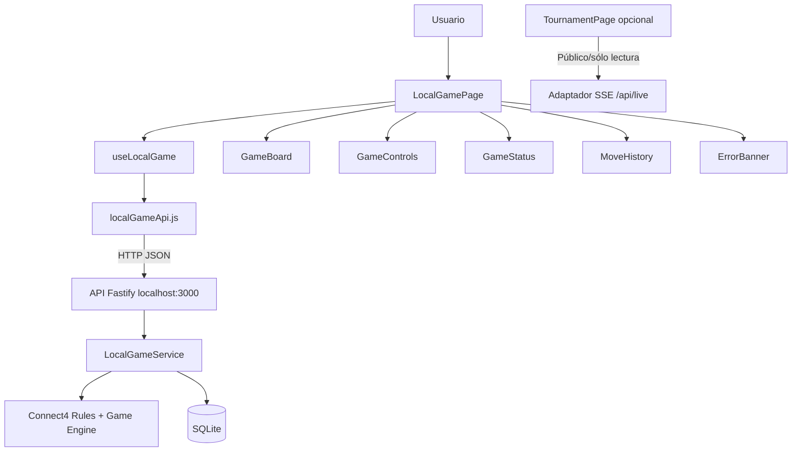

# PLAN_FRONTEND.md — Arquitectura e implementación del frontend Connect4 8×7

**Versión:** 2.1 · **Estado:** Contrato técnico propuesto para validación del equipo antes de implementar.  
**Responsable principal:** América (UI/UX y frontend). **Integración:** Juan (API), Alex (QA), Salva (arquitectura), Jorge (reglas/engine).  
**Dependencias de diseño:** contratos de la API local definidos conjuntamente con `PLAN_BACKEND.md` y especificación del servidor árbitro HTTP OpenAPI `1.0.1` únicamente para funcionalidades públicas de observación.

> **Secuencia de implementación:** validar junto al backend los contratos de datos y de interacción, versionar ambos planes antes del código y registrar cambios posteriores mediante decisiones técnicas (`docs/TECNICO.md` y `docs/ADR.md`).

## 1. Producto y experiencia objetivo

Construir una aplicación web donde **una persona juegue contra el mismo bot usado por el worker de partidas remotas**. El tablero es de 8 columnas × 7 filas, con jugadas al elegir columnas, no casillas específicas. La interfaz debe permitir: seleccionar si inicia humano o bot, comenzar/reiniciar, visualizar el turno, identificar columnas disponibles, mostrar fichas y resultado (victoria, empate, línea ganadora), y funcionar cómodamente en una laptop. El móvil es una mejora deseable. El frontend **no implementa reglas propias que decidan el ganador** ni algoritmos de IA: renderiza el estado que devuelve la API.

**Dos superficies de producto independientes:**

1. **Juego humano local (funcionalidad base):** React → API local Fastify → Game Service/Engine → SQLite. No requiere conectarse al árbitro remoto ni token del equipo.
2. **Observatorio del torneo (opcional P2):** mostrar resultados públicos, fases y partidas en vivo del árbitro a través de un adaptador/proxy backend o API pública de solo lectura (`GET /api/state`, SSE `/api/live`); nunca usar rutas que requieren el token en el navegador.

**No agregar botones que disparen partidas remotas administradas por el árbitro:** el árbitro controla el torneo y el bot-worker obtiene turnos por long polling. El frontend local no participa en ese ciclo.

## 2. Decisiones técnicas y de arquitectura

| Aspecto | Decisión | Motivo |
|---|---|---|
| Lenguaje | **JavaScript ESM + JSX**, JSDoc para contratos | Preferencia y experiencia del equipo; sin TypeScript. |
| UI | **React 18+ y Vite** | Desarrollo local rápido, código exportable, fácil demo. |
| Estilos | CSS Modules o CSS propio con variables/tokens | Evitar dependencia de librerías visuales grandes; elegir **CSS Modules** como base. |
| Cliente HTTP | `fetch` envuelto en `src/api/http-client.js` | API pequeña, control de errores y abort. |
| Estado UI | Hooks React + controlador `useLocalGame()` | No añadir Redux/Zustand si el tamaño no lo requiere. |
| Routing | `react-router-dom` solo si se implementan varias rutas reales | Partida principal puede funcionar en `/`; histórico/rankings necesitan router. Se adopta router ligero para `/`, `/history`, `/about`. |
| Validación | Contratos y validadores en fronteras; JSDoc | Nunca asumir respuestas correctas solo porque son internas. |
| Pruebas | Vitest + React Testing Library | Compatible con suite raíz y pruebas de interacción. |
| Accesibilidad | Botones semánticos, teclado, `aria-live`, contraste | Usabilidad real; evitar interfaces solo visuales. |
| Persistencia | API + SQLite; `localStorage` solo para último `gameId`/preferencias | El backend mantiene autoridad de juego. |
| Modo en vivo | SSE **si se implementa** | Árbitro v1.0.1 publica `/api/live`; no necesitamos WebSocket para turno humano por petición. |
| Monorepo | `apps/web` con npm workspace | Repositorio único con dependencias compartidas y aplicaciones ejecutables independientemente. |

**Principio:** separar presentación, estado UI y acceso a datos. Componentes React no conocen algoritmos minimax, almacenamiento SQLite ni token de árbitro. Nada de lógica duplicada de victoria/empate en el cliente. El API devuelve la verdad; UI solo transforma coordenadas a presentación.

## 3. Arquitectura de componentes y flujo



**Flujo humano:** React pide crear partida; backend guarda estado y lo devuelve; usuario pulsa columna legal; React envía `POST /moves` con identificador idempotente; backend valida/aplica su ficha y la respuesta del bot; React muestra la nueva posición. Si el backend necesita completar el cálculo de manera diferida, el cliente muestra “Bot pensando” y consulta el juego hasta obtener nuevo estado. Al recargar, se recupera por `gameId` del `localStorage`, pero se valida contra el backend.

**Flujo del bot al abrir:** al crear partida con `humanPlayer:2`, el servidor ejecuta primera jugada del bot y responde con tablero actualizado (o estado `isBotThinking` mientras termina). React solo muestra el turno correcto.

## 4. Estructura exacta del frontend

```text
apps/web/
├── package.json
├── index.html
├── vite.config.js
├── public/
│   └── favicon.svg
└── src/
    ├── main.jsx
    ├── App.jsx
    ├── router.jsx
    ├── api/
    │   ├── http-client.js
    │   └── local-game-api.js
    ├── hooks/
    │   ├── use-local-game.js
    │   └── use-game-preferences.js
    ├── pages/
    │   ├── local-game-page.jsx
    │   ├── history-page.jsx
    │   ├── about-page.jsx
    │   └── tournament-page.jsx       # Opcional, si se implementa
    ├── components/
    │   ├── game-board.jsx
    │   ├── game-cell.jsx
    │   ├── column-control.jsx
    │   ├── game-controls.jsx
    │   ├── game-status.jsx
    │   ├── game-result.jsx
    │   ├── move-history.jsx
    │   ├── connection-banner.jsx
    │   ├── loading-indicator.jsx
    │   └── error-banner.jsx
    ├── styles/
    │   ├── tokens.css
    │   ├── global.css
    │   ├── game-board.module.css
    │   └── game-page.module.css
    └── utils/
        ├── display-board.js
        ├── humanize-error.js
        └── game-labels.js
```

Se eliminan o agregan componentes solamente si surge una responsabilidad real; no se crean “arquitecturas” con archivos de una línea. `src/api` no importa React; hooks gestionan estado; componentes visuales reciben props y callbacks.

## 5. Vistas y casos de uso

### 5.1 Pantalla principal `/` — Juego humano (P0)

**Zona superior:** nombre del juego/equipo, breve instrucción (“Elige una columna para soltar tu ficha”), indicador de conexión.

**Configuración antes de comenzar:** selector “Empieza: Yo / Bot”, selector opcional de dificultad (`basic`, `search`), botón “Nueva partida”. Configurar color de humano/bot sin asumir que humano siempre es jugador 1.

**Tablero:** ocho columnas, siete filas; colores consistentes, fichas con alto contraste, animación opcional de caída; botón/control de columna en la parte superior para teclado/touch; visualización de `legalMoves`. Mostrar índices 0–7 cuando aporten claridad, sin exigir que el usuario conozca la representación interna.

**Lateral o inferior:** turno actual, estado de cálculo, historial de jugadas, resultado final, botón nueva partida, indicador de “Sin conexión / Reintentar”.

**P0 visual:** diseño ordenado, no saturado; estado deshabilitado claro, línea ganadora resaltada, indicador de primer turno. No depender de animaciones para entender el juego.

### 5.2 Historial `/history` (P1)

Lista de partidas locales recientes: fecha, quién inició, resultado, cantidad de movimientos, estrategia usada. Seleccionar una partida puede mostrar el estado final y la secuencia de movimientos si el endpoint de movimientos existe. La fuente es SQLite mediante API, no `localStorage`.

### 5.3 Acerca de `/about` (P1)

Explica las reglas del juego y cómo jugar, orientado a usuario final. No confundir esta pantalla con `docs/MANUAL.md`, que debe incluir capturas reales y pasos de instalación/uso.

### 5.4 Vista torneo `/tournament` (P2, solo si implementada)

Mostrar fase, tabla de posiciones y partida seleccionada usando endpoints **públicos**. `/api/games` no trae `board`; hay que solicitar `/api/games/{game_id}`. El SSE público `/api/live` emite snapshots. No filtrar token del equipo al navegador, no enviar jugadas oficiales desde React. La demo oficial ya la ofrece Yompi; nuestra vista es valor adicional.

## 6. Componentes y contrato de props

| Componente | Props/entrada | Salida / acción | Validación de UX |
|---|---|---|---|
| `GameBoard` | `board`, `legalMoves`, `winningCells`, `disabled` | `onColumnSelect(column)` | 8 columnas y 7 filas; fila 0 abajo visualmente. |
| `ColumnControl` | `column`, `canPlay`, `disabled` | click/tecla | Deshabilitado cuando no es turno humano o columna llena. |
| `GameCell` | `value`, `isWinningCell`, `row`, `column` | solo presentación | Vacío/1/2; resaltado ganador accesible. |
| `GameControls` | `humanPlayer`, `strategy`, `busy` | `onNewGame`, `onChangeSettings` | Impide cambios que corrompan una partida activa. |
| `GameStatus` | `state`, `pending`, `error` | — | Texto inequívoco “Tu turno”, “Bot pensando”, “Ganaste”, etc. |
| `GameResult` | `status`, `winner`, `humanPlayer` | `onPlayAgain` | No asumir que `winner=1` significa humano. |
| `MoveHistory` | `moves`, `humanPlayer` | opcional replay | Turno y columna claros. |
| `ConnectionBanner` | `online`, `retryable` | `onRetry` | No indicar “movimiento aceptado” sin respuesta del backend. |
| `ErrorBanner` | `errorCode`, `message` | dismiss/retry | Errores comprensibles; sin stack traces. |

### 6.1 Inversión de filas: fuente frecuente de bugs

La API entrega `board[0]` como la fila inferior. Para mostrar una matriz en CSS Grid de arriba hacia abajo:

```javascript
const displayRows = [...board].reverse();
```

**Nunca invertir o mutar `board` original** ni cambiar su contrato para acomodar React. Los índices al destacar `winningCells` se mantienen en coordenadas originales y se transforman durante render, sin alterar datos del servidor.

## 7. Contrato HTTP exacto con backend local

**Base:** `VITE_API_BASE_URL=http://localhost:3000/api`; los endpoints son nuestros, separados de los del árbitro. `fetch` con JSON, timeouts razonables/AbortController e identificación de errores. En desarrollo Vite puede hacer proxy `/api` a 3000 para simplificar CORS.

| Método | Ruta | Request | Response |
|---|---|---|---|
| `POST` | `/api/local-games` | `{humanPlayer:1\|2,strategy?:'basic'\|'search'}` | `{gameId,state,moves}` |
| `GET` | `/api/local-games/:gameId` | — | `{gameId,state,moves}` |
| `POST` | `/api/local-games/:gameId/moves` | `{column:0..7,clientMoveId:string}` | `{gameId,state,moves,lastActions}` |
| `GET` | `/api/local-games/:gameId/moves` | — | `{items:[{turn,player,column,...}]}` |
| `GET` | `/api/local-games?limit=20` | — | `{items,total}` |
| `GET` | `/api/stats` | — | `{played,won,lost,drawn}` |
| `GET` | `/api/health` | — | `{ok:true,service:'api'}` |

**Estado esperado:**

```json
{
  "gameId": "local_a72",
  "state": {
    "board": [[0,0,0,0,0,0,0,0],[0,0,0,0,0,0,0,0],[0,0,0,0,0,0,0,0],[0,0,0,0,0,0,0,0],[0,0,0,0,0,0,0,0],[0,0,0,0,0,0,0,0],[0,0,0,0,0,0,0,0]],
    "currentPlayer": 1,
    "humanPlayer": 1,
    "status": "playing",
    "winner": null,
    "winningCells": [],
    "legalMoves": [0,1,2,3,4,5,6,7],
    "isBotThinking": false
  },
  "moves": []
}
```

**Error común (propio de nuestra API):**

```json
{
  "error": {
    "code": "NOT_YOUR_TURN",
    "message": "Espera el movimiento del bot."
  }
}
```

**Códigos de error UI:** `INVALID_COLUMN`, `COLUMN_FULL`, `NOT_YOUR_TURN`, `GAME_FINISHED`, `GAME_NOT_FOUND`, `DUPLICATE_MOVE`, `API_UNAVAILABLE`, `UNEXPECTED_ERROR`. El backend define la semántica final. Para doble envío con `clientMoveId` idéntico, el backend debería responder idempotentemente; React genera UUID por intento de acción de usuario y reutiliza el mismo UUID al reintentar esa acción, no uno nuevo.

**Importante:** no usar `/api/move` del árbitro para la partida humana. El token del árbitro nunca entra en variables `VITE_*` ni en el bundle web.

## 8. Hook de estado principal y catálogo de funciones

**Modelo sugerido de `useLocalGame()`**:

```javascript
{
  gameId, game, moves, isLoading, isSubmitting, isBotThinking,
  error, connectionState,
  createGame, selectColumn, refreshGame, retryLastAction, resetGame
}
```

| Función | Efecto |
|---|---|
| `createGame(options)` | POST crear; guarda gameId en storage tras éxito; actualiza vista. |
| `loadGame(id)` | GET restaurar; si 404, ofrecer nueva partida. |
| `selectColumn(column)` | Verifica interacción habilitada, genera `clientMoveId`, POST y actualiza estado solo tras respuesta. |
| `refreshGame()` | Recupera estado si hubo POST dudoso o bot pensando. |
| `retryLastAction()` | Reintenta misma intención con mismo `clientMoveId`, evita duplicados. |
| `resetGame()` | Inicia otra partida; no borra la anterior de SQLite. |
| `canSelectColumn(column)` | `status=playing && currentPlayer=humanPlayer && legalMoves.includes(column) && !pending`. |
| `displayRows(board)` | Inversión no mutante de filas para render. |
| `formatGameStatus(state)` | Mensajes de estado sin inferir reglas de victoria. |
| `mapHttpError(response)` | Traduce errores HTTP/código a mensajes humanos y acción de reintento. |

**No mover a frontend:** `applyMove`, `checkWinner`, minimax, heurística, reglas del árbitro, generador de `legalMoves` como fuente oficial.

## 9. Máquina de estados de experiencia

```text
INITIAL → CREATING → HUMAN_TURN
                     ↘ BOT_THINKING
HUMAN_TURN → SUBMITTING → BOT_THINKING → HUMAN_TURN
                                   ↘ FINISHED
HUMAN_TURN → SUBMITTING → FINISHED
SUBMITTING → CONNECTION_UNCERTAIN → REFRESHING → HUMAN_TURN/BOT_THINKING/FINISHED
cualquier estado → ERROR_RETRYABLE (si HTTP falla)
FINISHED → CREATING (jugar de nuevo)
```

**Reglas de transición:**

1. Clic inválido/columna llena/turno ajeno: no enviar POST; deshabilitar control.
2. Durante POST: deshabilitar tablero, indicar procesamiento; al fallar la red, **no** aplicar jugada optimista permanente.
3. Cuando servidor reporta `isBotThinking=true`, polling acotado `GET /api/local-games/:id` o SSE local si existe. Cancelar polling al desmontar componente. No empezar dos timers.
4. Si recarga web: recuperar `lastGameId`; si no existe, mostrar inicio; al cambiar backend no confiar en estado viejo guardado en navegador.
5. Ante error de red tras POST: primero GET para reconciliar; si se reenvía, mantener mismo `clientMoveId`.
6. Final de juego: deshabilitar columnas, resaltar `winningCells` o mostrar empate, permitir nueva partida.

## 10. Diseño visual y responsive

**Propuesta visual**: tablero azul moderado, fichas amarillo y coral/rojo, fondo claro limpio, tarjetas discretas y buen contraste, sin estética robótica. El color no será el único identificador de turno: se mostrarán textos/íconos y nombres de jugador.

**Tokens CSS iniciales (ajustables tras revisar prototipo):**

```css
:root {
  --color-background: #f5f7fb;
  --color-surface: #ffffff;
  --color-text: #172033;
  --color-muted: #5e6a7f;
  --color-board: #2563b8;
  --color-player-one: #f5c84b;
  --color-player-two: #ed6b64;
  --color-empty: #e8edf5;
  --color-success: #187b54;
  --color-danger: #b83d3d;
  --radius-card: 16px;
}
```

**Layout:** desktop: tablero protagonista + panel lateral de turno/controles/historial; móvil: tablero full-width y controles debajo, sin scroll horizontal. Celdas uniformes mediante CSS Grid `repeat(8,minmax(0,1fr))`; conservar proporción circular. Botones con área táctil suficiente; mantener tablero entendible en laptop proyectada.

**Accesibilidad:** controles `<button>` reales por columna; `aria-label="Jugar en columna 4"`; `aria-live="polite"` para turno; `aria-live="assertive"` para resultado/error crítico; foco visible, teclado tab/enter, contrastes suficientes; animaciones no esenciales y respeto `prefers-reduced-motion`.

**Animaciones:** transiciones suaves para mostrar caída de ficha si se implementan correctamente; no alterar sincronización con servidor ni calcular posiciones de manera diferente al contrato. Mostrar siempre la versión confirmada del tablero.

## 11. Conexiones y tecnologías en tiempo real

- **Humano ↔ API:** HTTP JSON suficiente para turnos. No WebSocket obligatorio.
- **Bot ↔ árbitro:** HTTP long polling desde worker; no pasa por React.
- **Visualización de torneo:** árbitro v1.0.1 ofrece SSE `/api/live` (evento `state`) y `/api/state`. Puede usarse para vista de solo lectura si se implementa. `/api/games` devuelve resumen sin tablero; detalle sí tiene tablero.
- **Telemetría del engine en web:** podría añadirse SSE local para profundidad, nodos y mejor jugada, sin afectar latencia ni exponer secretos. Flags OFF hasta que esté probado.
- **WebSockets futuros:** útil en multijugador humano↔humano, chat o coordinación bidireccional; arquitectura permite adaptador de eventos sin reescribir engine.

## 12. Persistencia, privacidad y fallos

**LocalStorage permitido:** `lastGameId`, preferencia de sonido/tema, dificultad preferida; no tableros como verdad, no token del árbitro, no diagnósticos sensibles. **SQLite backend:** partidas, movimientos e historial. **Al refrescar:** el hook vuelve a consultar la partida y obtiene el estado más reciente.

**Matriz de fallo UI:**

| Caso | Comportamiento visible |
|---|---|
| API desconectada | Banner “No podemos conectar con el juego”; reintento; conservar `gameId`. |
| POST enviado sin respuesta | Indicar estado incierto, GET antes de nuevo intento; reusar `clientMoveId`. |
| Sesión inexistente | Aviso no técnico y botón nueva partida. |
| Columna llena | Botón inactivo; si API rechaza, actualizar desde servidor. |
| Bot calculando | Spinner/etiqueta; no habilitar columnas. |
| Usuario cierra pestaña | Último gameId sigue guardado, backend conserva partida. |
| Juego finalizado | Ganador/empate y línea resaltada; sin acciones ilegales. |
| Red hacia árbitro cae | No afecta partida humana local; vista de torneo opcional indica desconexión. |

## 13. Pruebas del frontend

**Comando común:** `npm test` desde la raíz. Las pruebas de web se integran a Vitest con React Testing Library; las pruebas backend y de motor siguen en la misma ejecución.

| Suite | Criterios de prueba |
|---|---|
| Board render | Exactamente 7×8, coordenada inferior correcta, fichas 0/1/2, línea ganadora. |
| Controls | `humanPlayer` 1/2, `strategy`, crear y reiniciar. |
| Interaction | Click válido produce POST, columna llena deshabilitada, doble click una sola petición. |
| Async states | `pending`, bot pensando, cambios de turno, finished, empate. |
| Error | API offline, timeout, POST incierto, 404, 409 y mensajes claros. |
| Recovery | Recarga con `lastGameId`; invalidez del ID; reemplazo de estado al consultar backend. |
| Usabilidad | Navegación por teclado, foco, labels, laptop y viewport móvil. |
| E2E con mock API | Una partida completa sin algoritmos implementados en React. |

**Cobertura del frontend:** objetivo >=75% de componentes/hook cruciales, aunque los umbrales oficiales de >=70% se refieren específicamente a reglas y algoritmo; no confundir métricas. La UI debe pasar evaluación manual en laptop proyectada y móvil.

## 14. Orden de implementación y responsabilidades

### Fase 0 — Antes de código (América + Juan + Salva)

- Aprobar `POST /api/local-games`, `GET /api/local-games/:id`, `POST /api/local-games/:id/moves` y los ejemplos JSON.
- Decidir que la autoridad sea backend/SQLite, render de fila 0 inferior y estados definidos.
- Revisar este plan y `PLAN_BACKEND.md`; primer commit de documentos y luego `AGENTS.md`.
- Definir diseño mínimo, color de fichas y controles accesibles.

### Fase 1 — UI con fixtures (América; QA Alex)

- Crear React/Vite con tablero 8×7 a partir de fixture **coherente**.
- Implementar pantalla inicial, selección humano/bot, controles de columnas, turno, victoria/empate.
- Usar cliente simulado compatible con backend; no programar reglas dentro de React.
- Resultado verificable: UI funcional con fixtures y pruebas de render e interacción.

### Fase 2 — Integración con API (América + Juan)

- Juan publica rutas y ejemplos; América implementa cliente `fetch` y `useLocalGame`.
- Probar crear partida con humano primero y bot primero, enviar movimiento y obtener respuesta del engine.
- Validar `clientMoveId`, doble clic, estado `isBotThinking`, errores y recargas.
- Resultado verificable: una partida humana completa utiliza el **mismo engine** del worker remoto.

### Fase 3 — Persistencia y experiencia robusta (Juan + América + Alex)

- Conectar SQLite de API, recuperación por último `gameId`, listado histórico y errores.
- Pruebas de app cerrada, API reiniciada, red interrumpida, game no encontrado.
- Resultado verificable: recuperación de partidas, mensajes claros y estados consistentes.

### Fase 4 — Acabado visual, pruebas y documentación (América + Alex; aprobación de interfaces por el equipo)

- Refinar estilos, responsive laptop/móvil, accesibilidad y capturas reales.
- Escribir `docs/MANUAL.md`: qué es, instalación/apertura, controles, ejemplo de partida, errores, capturas.
- Registrar en `docs/TECNICO.md` decisiones y diferencias del plan; capturar evidencia de tests.
- Resultado verificable: aplicación utilizable sin instrucciones verbales adicionales.

### Fase P2 — Vista torneo / SSE / telemetría

- Implementar solo si la partida humana, worker y tests cumplen P0/P1.
- No mostrar funcionalidades inexistentes ni confundir transmisión SSE con transporte oficial de jugadas.
- Validar actualización, reconexión, limpieza de `EventSource` y datos sin `board` en `/api/games`.

## 15. Dependencias entre integrantes y control de integración

| Necesidad de América | Proveedor | Contrato de entrega |
|---|---|---|
| API y payloads | Juan | Esquemas JSON pactados, Fastify ejecutable y datos coherentes. |
| Tablero/reglas oficiales | Jorge | Semántica fila 0 abajo, `winningCells` y `legalMoves`. |
| Arquitectura y alcance | Salva | Monorepo scripts, rutas definitivas, decisiones y criterios de aceptación. |
| Escenarios y QA | Alex | Fixtures válidos, pruebas visuales, manual de fallos y reporte de bugs. |
| Contrato del servidor remoto | Salva | El juego humano no depende del árbitro; las vistas públicas opcionales solo consultan rutas de lectura. |

**Flujo por tarea:** requisito → contrato/payload → componente aislado → prueba de usuario → integración HTTP → revisión por par → merge/commit → actualizar documentación si cambió el contrato. Integrar progresivamente, sin acumular integraciones para el cierre del desarrollo.

## 16. Riesgos técnicos, mitigaciones y decisiones de diseño

| Riesgo | Mitigación |
|---|---|
| Mostrar tablero invertido | `displayRows` probado, fila 0 visualmente abajo. |
| Estado divergente UI/backend | Servidor autoridad, actualizaciones tras respuesta real, refresh al reconectar. |
| Doble POST por clic | Deshabilitar interacción y usar `clientMoveId` idempotente. |
| Interfaz poco legible a distancia | Jerarquía visual clara, tablero grande, contraste. |
| Generador v0/Lovable impone estructura difícil | Extraer código limpio y adaptarlo al repositorio; componentes locales independientes del hosting. |
| Datos del árbitro sin board en resumen | API detallada para replay; no asumir `board` en `/api/games`. |
| Gastar tiempo en pulido y no jugar | P0 completo antes de P2; validación end-to-end antes de mejoras opcionales. |

**Decisiones que deben permanecer explícitas:** React no determina ganadores ni juega por el bot; HTTP/JSON resuelve la interacción humana por turnos; SQLite recupera juegos; `clientMoveId` previene duplicados; el token remoto permanece en backend/worker; agregar juegos requiere un nuevo módulo de reglas/estrategia, no duplicar componentes HTTP.

## 17. Criterios de aceptación (Definition of Done)

- [ ] `PLAN_BACKEND.md` y `PLAN_FRONTEND.md` son los primeros commits, previos al código.
- [ ] Tablero 8×7, fila 0 abajo, columnas legibles, legalidad e indicador de turno.
- [ ] Seleccionar quién inicia, nueva partida, jugar, reiniciar y resultado correcto.
- [ ] Humano y bot utilizan backend real; nunca duplicar algoritmo de torneo en React.
- [ ] Resaltar cuatro fichas ganadoras; mostrar empate; deshabilitar tablero terminado.
- [ ] Evitar doble envío, cubrir carga, error y reconexión.
- [ ] Recuperar partida persistida por `gameId` tras recarga/cierre de pestaña.
- [ ] Interfaz limpia y usable en laptop, razonablemente responsive en móvil.
- [ ] Pruebas de componentes/hook integradas al comando único `npm test`.
- [ ] `docs/MANUAL.md` con capturas reales y pasos que una persona no técnica pueda seguir.
- [ ] No se filtra TEAM_TOKEN ni se depende del árbitro para jugar localmente.

**Conclusión:** la interfaz es un adaptador de presentación de un juego cuyo estado y motor residen en el backend. La independencia de la interfaz permite rediseñar React, añadir otro frontend o agregar un nuevo juego sin modificar las responsabilidades del cliente del árbitro oficial.
