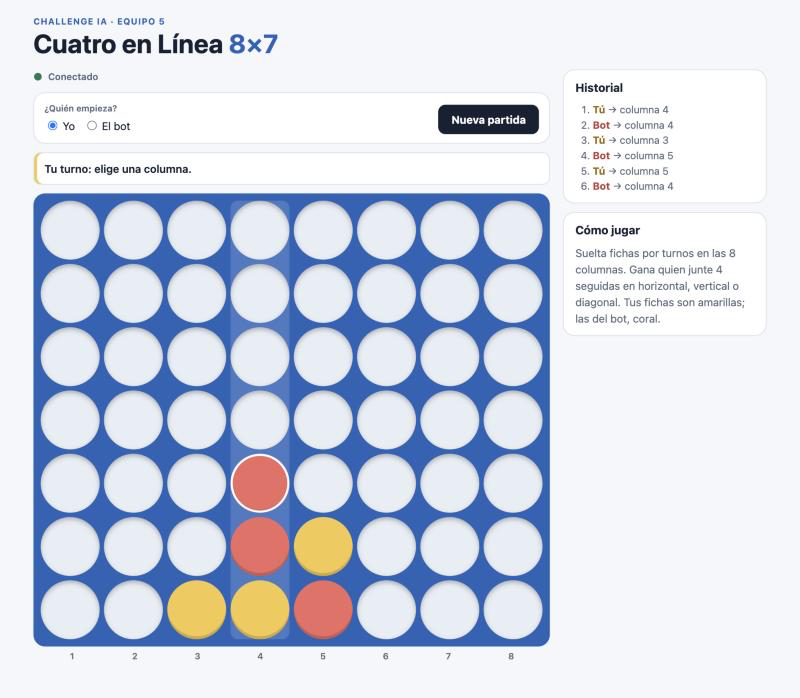

# Cuatro en Línea 8×7 — Equipo 5

Bot autónomo para el torneo (cliente HTTP del árbitro) + aplicación web para jugar
contra el mismo engine. Ver `PLAN_BACKEND.md`, `PLAN_FRONTEND.md` y `AGENTS.md`.
Documentación: [técnica](docs/TECNICO.md) · [manual de usuario](docs/MANUAL.md) ·
[API local](docs/API_LOCAL.md) · [benchmarks](docs/BENCHMARKS.md) · [uso de IA](docs/AI_DECISIONS.md) · [ADR](docs/ADR.md).



## Requisitos
- Node.js >= 20.19 (probado con 22.x y 24.x)
- macOS/Linux/Windows. `better-sqlite3` trae binarios precompilados; si `npm install` intenta compilar,
  instala las herramientas de compilación (macOS: `xcode-select --install`).

## Instalación
```bash
npm install          # instala backend y web/ (workspaces)
cp .env.example .env # completar ARBITRO_URL y TEAM_TOKEN el día del evento
npm test             # suite completa + cobertura; debe quedar en verde
```

## Comandos
| Comando | Qué hace |
|---|---|
| `npm test` | **Comando único de pruebas** con cobertura (Vitest). Falla si la cobertura baja del umbral |
| `npm run bot` | Worker del torneo: long polling al árbitro y envío de jugadas |
| `npm run api` | API local para el juego humano (`PORT`, default 3000) |
| `npm run dev:web` | Frontend React/Vite en http://localhost:5173 (proxy `/api` → `localhost:3000`) |
| `npm run mock` | Árbitro falso en http://localhost:4100 (token `token-dev`) para ensayar sin internet |
| `npm run train` | Self-play local reproducible (`-- --games 20 --seed 7 --a search --b basic --budget 50 [--save]`) |
| `npm run benchmark` | Matriz de estrategias + tiempos del engine → `docs/BENCHMARKS.md` |
| `npm run practice` | Crea partida de práctica contra bot de la casa (`-- casa-basico 1`) |
| `npm run submit` | Registra repo + commit en el árbitro (`-- <repo_url> [commit]`) |
| `npm run health` | Consulta `GET /api/health` y `GET /api/me` del árbitro |

Para evitar que la Mac se suspenda durante la liga:
```bash
./scripts/prevent-sleep-macos.sh npm run bot
```

## Variables de entorno
Ver `.env.example`. El token del equipo **nunca** se commitea ni aparece en logs.

| Variable | Uso | Default |
|---|---|---|
| `ARBITRO_URL`, `TEAM_TOKEN` | Árbitro oficial: `https://ai-challenge.yompi.com` y el token del equipo | — |
| `SEARCH_BUDGET_MS` | Presupuesto de búsqueda del bot **y** de la API local | 1500 |
| `PORT`, `DB_PATH` | API local | 3000, `./data/local.db` |
| `POLL_WAIT_SEC`, `BOT_STRATEGY` | Opcionales del worker | 20, `search` |

## Ensayo completo sin internet
```bash
# terminal 1: árbitro falso con 4 partidas de liga y 300 ms de latencia
MOCK_LEAGUE_GAMES=4 MOCK_MOVE_LATENCY_MS=300 npm run mock
# terminal 2: el bot contra el mock (las variables de la línea ganan sobre .env)
ARBITRO_URL=http://localhost:4100 TEAM_TOKEN=token-dev npm run bot
# terminal 3: práctica extra
ARBITRO_URL=http://localhost:4100 TEAM_TOKEN=token-dev npm run practice -- casa-basico 2
```

## Estructura
```
src/domain/connect4/   reglas puras del juego (sin HTTP/BD)
src/engine/            estrategias: básica y búsqueda negamax con deadline (bitboard)
src/application/       turn-orchestrator (torneo) y local-game-service (humano)
src/infrastructure/    cliente del árbitro, SQLite, API HTTP local (Express)
src/worker/            proceso persistente npm run bot (+ lock de instancia única)
src/observability/     logs JSON sin secretos y métricas
src/training/          self-play, benchmark
web/                   React + Vite (juego humano)
tests/                 suite Vitest: domain, engine, referee (mock), application, infrastructure, worker, web, integration
scripts/               practice, submission, health-check, prevent-sleep
docs/                  TECNICO.md, MANUAL.md, ADR.md, API_LOCAL.md, etc.
```

## Problemas frecuentes
| Síntoma | Causa | Solución |
|---|---|---|
| `Faltan ARBITRO_URL o TEAM_TOKEN` | No hay `.env` | `cp .env.example .env` y completar |
| `team_check_failed` con `http_401` | Token mal copiado | Revisar `TEAM_TOKEN` (sin comillas ni espacios) |
| `worker_already_running` | Ya hay un bot con ese token | Detener el otro (`Ctrl+C`); nunca dos bots a la vez |
| Web dice "Sin conexión con la API" | `npm run api` no está corriendo | Abrirlo en otra terminal |
| `npm install` falla en `better-sqlite3` | Faltan herramientas de compilación | macOS: `xcode-select --install`; reintentar |
| `npm test` falla por cobertura | Bajó del umbral (P5) | Agregar pruebas al módulo nuevo |
