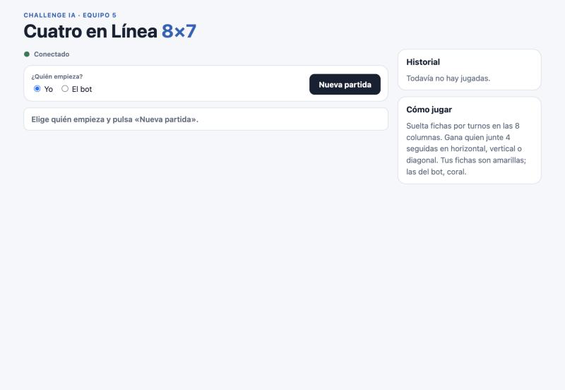
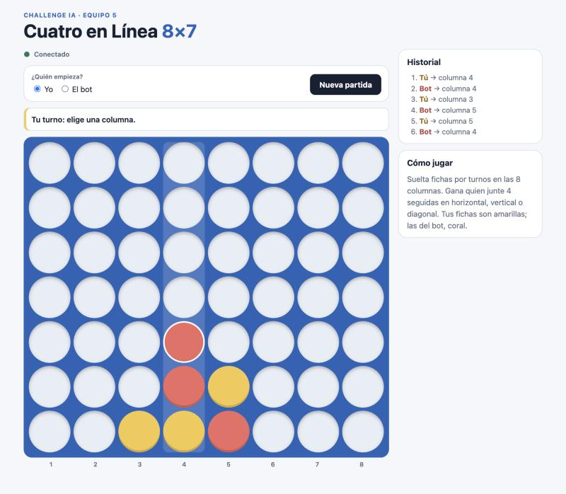
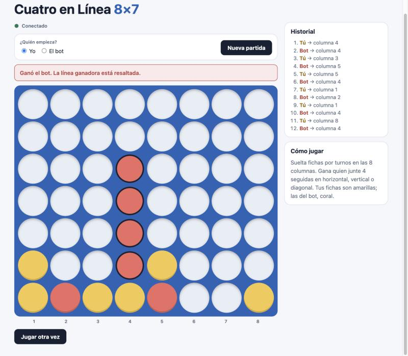
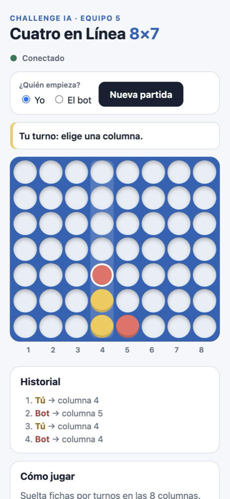
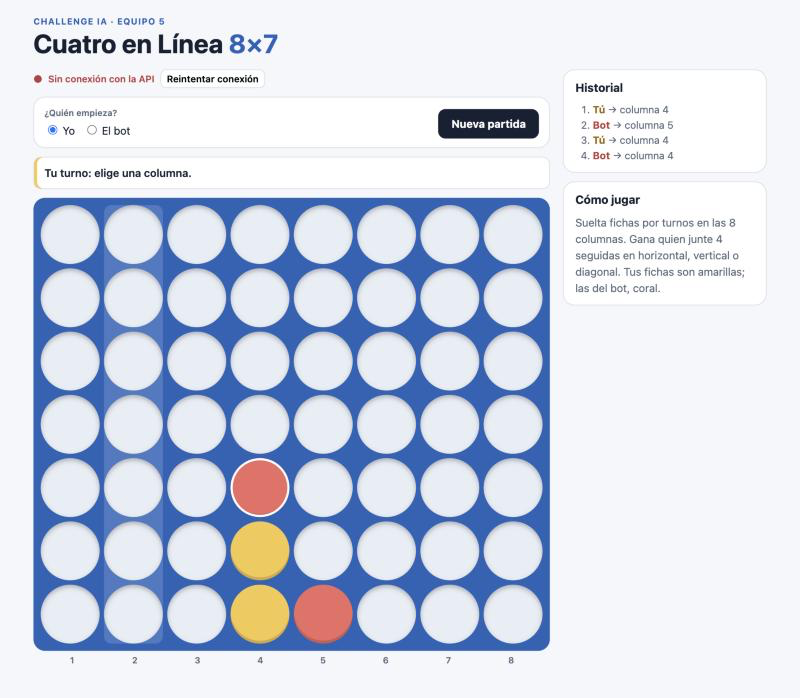

# Manual de usuario — Cuatro en Línea 8×7

> Entregable oficial (F05, América). Escrito para alguien que no programa,
> con capturas reales de la aplicación.

## ¿Qué es?
Un tablero de **Cuatro en Línea** de 8 columnas por 7 filas donde juegas contra nuestro bot. El bot de esta pantalla es
**el mismo** que compite en el torneo del Challenge, con el mismo tiempo para pensar.

## Cómo abrir la aplicación
La persona que prepara la computadora corre dos comandos en dos terminales (una sola vez):

1. `npm run api` — el "cerebro" del juego (guarda las partidas).
2. `npm run dev:web` — la pantalla.

Luego abre en el navegador **http://localhost:5173**.

Arriba a la izquierda ves **● Conectado**. Si dice **Sin conexión**, el paso 1 no está corriendo.

## Cómo jugar
1. En **¿Quién empieza?** elige **Yo** o **El bot**.
2. Pulsa **Nueva partida**. Si empieza el bot, su ficha ya aparece en el tablero.
3. Toca o haz clic en una **columna**: tu ficha (amarilla) cae al hueco libre más bajo.
4. El aviso cambia a **El bot está pensando…** y luego aparece su ficha (coral). Mientras piensa, el tablero no
   acepta clics, así que no puedes jugar dos veces por error.
5. A la derecha, el **Historial** muestra cada jugada en orden.

Las columnas están numeradas del **1 al 8**, de izquierda a derecha, y el Historial usa esos mismos números.
La última ficha jugada tiene un borde blanco. Una columna llena se ve más clara y no se puede elegir.

## Fin de la partida
Gana quien junte **4 fichas seguidas** en horizontal, vertical o diagonal. La línea ganadora queda **resaltada** y el
aviso dice quién ganó. Si se llenan las 56 casillas sin ganador, es **empate**. Pulsa **Jugar otra vez** para empezar.

## En el teléfono
La pantalla se acomoda sola: el tablero arriba y el historial debajo.

## Si algo sale mal

| Ves esto | Qué significa | Qué hacer |
|---|---|---|
| **● Sin conexión con la API** | El "cerebro" del juego no responde | Revisa que `npm run api` siga abierto y pulsa **Reintentar conexión** |
| **Perdimos la conexión mientras enviábamos tu jugada** | No sabemos si tu jugada llegó | Pulsa **Ver estado actual** (recomendado) o **Reintentar**; nunca se aplica dos veces |
| **Esa columna está llena o no existe** | Elegiste una columna sin espacio | Elige otra |
| La página se recargó o cerraste el navegador | — | Vuelve a abrir la dirección: tu última partida se recupera sola |

